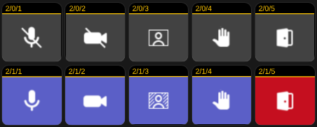

# companion-module-microsoft-teams

Bitfocus Companion module for controlling the Microsoft Teams desktop app through Teams' third-party device API (protocol 2.0.0). See [companion/HELP.md](companion/HELP.md) for setup and the list of actions and feedbacks.



Thanks to svrooij's work documenting the Teams API: https://github.com/svrooij/teams-monitor

## Development

Requires Node.js 22 and Yarn (`corepack enable`).

```sh
yarn install
yarn lint     # ESLint + Prettier checks
yarn format   # apply Prettier formatting
yarn test     # unit tests (node --test)
yarn build    # produce the installable .tgz package
```

To test in Companion without packaging, set the developer modules path in the Companion launcher to the folder that contains this repo.

### Layout

| File           | Purpose                                                           |
| -------------- | ----------------------------------------------------------------- |
| `index.js`     | Module instance: WebSocket connection, pairing, message handling  |
| `state.js`     | Meeting state fields; drives the feedbacks, variables and parsing |
| `actions.js`   | Action definitions                                                |
| `feedbacks.js` | Feedback definitions (generated from `state.js`)                  |
| `variables.js` | Variable definitions (generated from `state.js`)                  |
| `presets.js`   | Button presets                                                    |
| `config.js`    | Connection config fields                                          |
| `upgrade.js`   | Upgrade scripts for existing configs and buttons; append only     |
